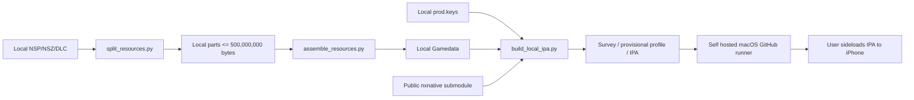

# Build and data architecture

The public repository is a build recipe and wrapper. The archive contents and
keys stay on the user's own storage. The first Torchlight II build is an
upstream provisional-profile experiment because no verified profile is present
yet; a playable build requires iterative bring-up on macOS and then testing on
the iPhone.
